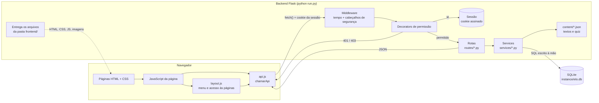
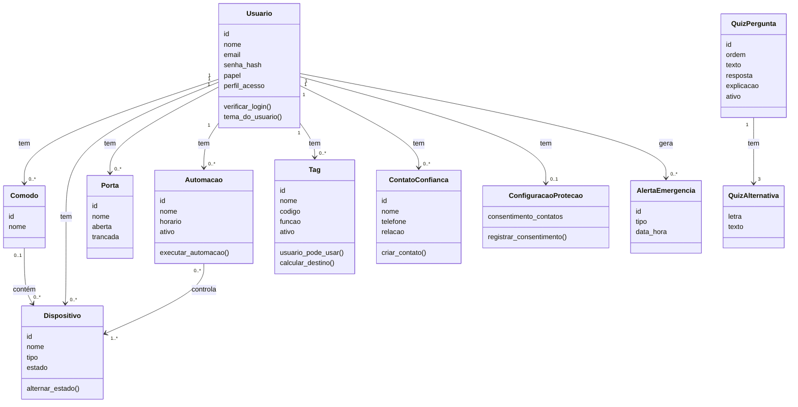
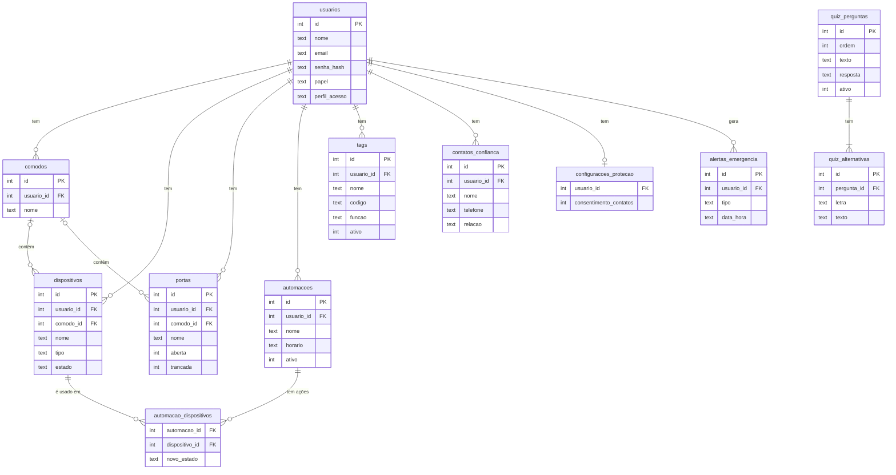
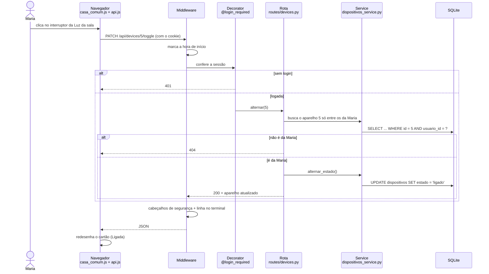

# E.L.O. — Escuta, Liberdade e Orientação

Plataforma web de **casa inteligente** com uma **área de proteção e orientação para mulheres** em situação de violência doméstica.
Projeto acadêmico em grupo — 4º semestre.

> O conteúdo da área de proteção é informativo e **não substitui** atendimento de emergência, jurídico, psicológico ou policial.
> **Em situação de emergência, ligue 190. Para orientação, ligue 180.**

---

## Sumário

1. [O que é o E.L.O.](#1-o-que-é-o-elo)
2. [Funcionalidades por perfil](#2-funcionalidades-por-perfil)
3. [Tecnologias](#3-tecnologias)
4. [Arquitetura](#4-arquitetura)
5. [Diagramas](#5-diagramas)
6. [Estrutura de pastas](#6-estrutura-de-pastas)
7. [Como rodar o projeto](#7-como-rodar-o-projeto)
8. [Usuários de demonstração](#8-usuários-de-demonstração)
9. [Banco de dados](#9-banco-de-dados)
10. [Segurança e privacidade](#10-segurança-e-privacidade)
11. [Conteúdo editável](#11-conteúdo-editável)
12. [Testes](#12-testes)
13. [Documentação do projeto](#13-documentação-do-projeto)
14. [Como o projeto foi desenvolvido](#14-como-o-projeto-foi-desenvolvido)
15. [Limitações e próximos passos](#15-limitações-e-próximos-passos)
16. [Fontes do conteúdo](#16-fontes-do-conteúdo)

---

## 1. O que é o E.L.O.

O E.L.O. une duas partes:

- **Casa inteligente:** cômodos, aparelhos, câmeras, portas, rotinas (automações) e Tags (atalhos tipo NFC). Tudo é **simulado**: não há hardware, sensores ou câmeras reais. Ligar uma luz muda o estado dela no banco de dados e a tela mostra o novo estado.
- **Proteção E.L.O.:** área de informação e prevenção, com orientações, tipos de violência, perguntas frequentes, quiz educativo, contatos de confiança, "Preciso de ajuda" e o botão **Sair rápido**. Aparece **só para o perfil mulher**. Acessar a área não significa que a pessoa seja vítima.

**Nada é enviado de verdade:** o "Preciso de ajuda" apenas **simula** o alerta. Não há ligações, SMS nem integração com serviços oficiais.

---

## 2. Funcionalidades por perfil

O perfil é escolhido no cadastro, na pergunta **"Como você se identifica?"**. Depois, **só a própria pessoa** pode trocá-lo, em **Configurações**. O administrador apenas vê o perfil de cada conta.

| Perfil | Visual | O que acessa |
|-|-|-|
| **Mulher** | roxo | Minha casa (abas Início · Câmeras · Aparelhos · Avisos · Tags · Rotinas; o Início traz também **Consumo de energia** e **Moradores**), **Proteção E.L.O.**, Fale conosco e Configurações |
| **Homem** | escuro | Casa inteligente com menu lateral (Início, Minha casa, Ambientes, Dispositivos, Automações, Tags e Configurações). Sem a Proteção |
| **Prefiro não informar** (não definido) | escuro | O mesmo do perfil homem. Aparece no aviso "Contas novas" do admin, até a pessoa definir o perfil |
| **Administrador** | escuro | A casa inteligente + **Administração** (usuários, cômodos, dispositivos e Tags; os perfis aparecem só para consulta). Sem a Proteção |

**Configurações (visual roxo):** "Perfil e conta" funciona (nome, e-mail e "Como você se identifica?"); "Senha e segurança", "Notificações" e "Aparência e acessibilidade" aparecem com o selo **"Em breve"**; "Privacidade" explica como os dados são tratados.

As telas de **login e cadastro são neutras para todos**: falam só da casa inteligente, sem citar a Proteção. Assim, quem abrir o site não descobre que a área existe.

---

## 3. Tecnologias

| Camada | Tecnologia | Por quê |
|-|-|-|
| Backend | **Python + Flask** (API REST em JSON, organizada em Blueprints) | Simples e muito usado para ensinar web em Python |
| Banco de dados | **SQLite** com o módulo `sqlite3` e SQL escrito à mão | Não precisa instalar servidor; sem ORM, cada consulta fica visível |
| Login | **Sessão do Flask** + senha com hash (`werkzeug.security`) | Cookie assinado; a senha nunca é salva, só o hash |
| Frontend | **HTML + CSS + JavaScript puro** | Sem frameworks: o que está na tela é o que está no arquivo |
| Comunicação | `fetch()` do JavaScript chamando a API | O próprio Flask entrega as páginas, então frontend e API ficam no mesmo endereço |
| Testes | **pytest** com o `test_client` do Flask | Testa a API sem abrir o navegador |

Dependências (`backend/requirements.txt`): **Flask**, **python-dotenv** e **pytest**.
A fonte Poppins fica dentro do projeto (`frontend/fonts/`, licença OFL), para o navegador não precisar acessar nenhum site externo.

---

## 4. Arquitetura



**O caminho de um pedido**, por exemplo ligar uma luz:

1. A página chama `chamarApi("PATCH", "/api/devices/5/toggle")` (`frontend/js/api.js`). O `fetch()` envia o pedido junto com o cookie da sessão.
2. O **middleware** (`backend/app/middleware.py`) marca a hora de início. Ele roda em **todos** os pedidos.
3. O **decorator** da rota (`backend/app/utils/decorators.py`) lê a sessão: sem login → **401**; sem permissão → **403**.
4. A **rota** (`routes/devices.py`) recebe o pedido e chama o **service** (`services/dispositivos_service.py`), que aplica a regra e grava no **SQLite**, sempre filtrando pelo `usuario_id` de quem está logado.
5. A resposta volta em **JSON**. O middleware acrescenta os cabeçalhos de segurança e imprime no terminal `[14:03:22] PATCH /api/devices/5/toggle → 200 (3 ms)`.
6. O JavaScript redesenha a tela.

---

## 5. Diagramas

### 5.1 Diagrama de classes (modelo de domínio)

O código usa **módulos e funções** (não classes Python), para ficar simples. Este diagrama mostra as **entidades do sistema**, com os dados de cada uma (as colunas do banco) e as principais operações (as funções dos services).



### 5.2 Diagrama do banco de dados (entidade-relacionamento)

Todas as tabelas de dados pessoais têm a coluna `usuario_id`, que liga cada registro ao seu dono.



### 5.3 Diagrama de sequência (ligar um aparelho)

O caminho completo de um clique no interruptor, passando pelo middleware, pelo decorator, pela rota, pelo service e pelo banco.



A navegação entre as telas está em `docs/figma/FLUXO_NAVEGACAO.md`.

---

## 6. Estrutura de pastas

```
elo/
├── backend/
│   ├── app/
│   │   ├── __init__.py       # create_app(): monta o Flask, registra as rotas e entrega o frontend
│   │   ├── config.py         # lê as configurações do .env
│   │   ├── middleware.py     # roda em todo pedido: tempo no terminal + cabeçalhos de segurança
│   │   ├── content/          # textos editáveis: protecao.json, quiz.json, homem.json
│   │   ├── database/         # schema.sql (tabelas), db.py (conexão), seed.py (dados), recarregar_quiz.py
│   │   ├── routes/           # rotas da API (Blueprints): recebem o pedido e devolvem JSON
│   │   ├── services/         # regras de negócio e consultas ao banco
│   │   └── utils/            # decorators de permissão, leitura de pedidos e respostas de erro
│   ├── tests/                # testes com pytest (banco temporário)
│   ├── run.py                # ponto de entrada: python run.py
│   ├── pytest.ini
│   ├── requirements.txt
│   └── .env.example          # modelo do arquivo de configuração
├── frontend/
│   ├── index.html            # tela de login
│   ├── pages/                # telas do visual roxo (perfil mulher)
│   │   └── escuro/           # telas do visual escuro (homem, não definido e admin)
│   ├── css/                  # visual roxo e visual escuro (separados, não se misturam)
│   ├── js/                   # api.js, layout.js, saida_rapida.js, casa_comum.js e um arquivo por tela
│   │   └── escuro/           # scripts das telas escuras
│   ├── img/                  # logo, ilustração e ícones
│   └── fonts/                # fonte Poppins (com a licença)
├── docs/                     # documentação (ver seção 13)
├── README.md
└── .gitignore
```

Não existem pastas `models/` nem `schemas/`: com `sqlite3` puro, cada service já monta os dicionários que viram JSON.

---

## 7. Como rodar o projeto

Requisito: **Python 3.10 ou mais novo**. Todos os comandos são rodados **dentro da pasta `backend/`**.

### 7.1 Instalar

```bash
cd backend

# criar o ambiente virtual (uma pasta só com as bibliotecas deste projeto)
python -m venv venv           # no Windows, se não funcionar: py -m venv venv

# ativar o ambiente virtual
venv\Scripts\activate         # Windows
source venv/bin/activate      # Linux / macOS

# instalar as dependências
pip install -r requirements.txt
```

Com o ambiente ativado, o terminal mostra `(venv)` no começo da linha. É preciso ativá-lo sempre que abrir um terminal novo.

### 7.2 Configurar o `.env`

O `.env` guarda senhas e chaves, por isso **não vai para o GitHub**. Cada pessoa cria o seu a partir do modelo:

```bash
copy .env.example .env        # Windows
cp .env.example .env          # Linux / macOS
```

| Variável | Para que serve |
|-|-|
| `SECRET_KEY` | Assina o cookie da sessão. **Obrigatória.** Gere com `python -c "import secrets; print(secrets.token_hex(32))"` |
| `DATABASE_PATH` | Onde fica o banco (padrão: `instance/elo.db`) |
| `ADMIN_EMAIL` e `ADMIN_SENHA` | E-mail e senha do administrador criado pelo seed |
| `DEMO_SENHA` | Senha dos usuários de demonstração |
| `FLASK_DEBUG` | `1` mostra erros detalhados e reinicia o servidor quando o código muda. **Use só no seu computador** |

### 7.3 Criar o banco

```bash
python -m app.database.seed
```

O seed cria as tabelas, o administrador, os usuários de demonstração, uma casa de exemplo para cada um (cômodos, aparelhos, portas, a rotina "Modo Noite" e Tags; as Tags "Proteção" e "Emergência" só para a Maria) e as perguntas do quiz.

> **Atenção:** rodar o seed de novo **apaga tudo** e volta para os dados de demonstração. Para atualizar só o quiz, veja a seção 11.

### 7.4 Iniciar

```bash
python run.py
```

Abra no navegador: **http://localhost:5000**. O mesmo servidor entrega a API (`/api/...`) e as telas. Para parar, use `Ctrl + C`.

---

## 8. Usuários de demonstração

Criados pelo seed. Os e-mails são fictícios e as senhas vêm do `.env`.

| E-mail | Senha | Perfil | Para testar |
|-|-|-|-|
| valor de `ADMIN_EMAIL` | `ADMIN_SENHA` | administrador | Administração; a casa dele começa vazia |
| `maria@elo.exemplo` | `DEMO_SENHA` | mulher | Visual roxo e Proteção E.L.O. (já tem 2 contatos fictícios) |
| `joao@elo.exemplo` | `DEMO_SENHA` | homem | Visual escuro com menu lateral |
| `alex@elo.exemplo` | `DEMO_SENHA` | não definido | Visual escuro; aparece no aviso "Contas novas" da Administração |

**Dica:** para ver o aviso de consentimento dos contatos de confiança, entre como Alex, vá em **Configurações**, escolha **Mulher** em "Como você se identifica?" e abra a Proteção E.L.O.

---

## 9. Banco de dados

O banco é um arquivo só: `backend/instance/elo.db`. As tabelas estão em `backend/app/database/schema.sql`:

| Tabela | O que guarda |
|-|-|
| `usuarios` | Nome, e-mail, hash da senha, papel (usuário/admin) e perfil de acesso |
| `comodos` | Os cômodos de cada pessoa |
| `dispositivos` | Aparelhos e câmeras, com o estado (ligado, desligado, aberto, fechado) |
| `portas` | Portas, só para consulta (aberta/fechada, trancada/destrancada) |
| `automacoes` e `automacao_dispositivos` | As rotinas e o que cada uma faz em cada aparelho |
| `tags` | As Tags e a função de cada uma |
| `contatos_confianca` | Contatos de confiança (só do perfil mulher) |
| `configuracoes_protecao` | Consentimento e configurações de emergência |
| `alertas_emergencia` | Só o tipo e a hora das simulações de alerta |
| `quiz_perguntas` e `quiz_alternativas` | As perguntas do quiz (as respostas das usuárias **não** são salvas) |

Todo dado tem um `usuario_id` e **toda consulta filtra por ele**: uma pessoa nunca vê nem altera os dados de outra.

O diagrama entidade-relacionamento está na seção 5.2.

### Como visualizar o banco

Use o **DB Browser for SQLite** (gratuito: https://sqlitebrowser.org/dl/):

1. Abra o programa e clique em **Abrir banco de dados**.
2. Escolha `backend/instance/elo.db`.
3. Na aba **Navegar dados**, escolha uma tabela (ex.: `dispositivos`). Ligue uma luz no site e aperte **F5** no programa para ver o estado mudar.

Use o programa **só para olhar**: mudanças feitas por ele não passam pelas regras do sistema. Na tabela `usuarios`, a coluna `senha_hash` mostra só o hash, e a senha não aparece em lugar nenhum.

---

## 10. Segurança e privacidade

| Cuidado | Como funciona |
|-|-|
| **Senhas** | Guardadas só como hash (`generate_password_hash`); o login confere com `check_password_hash` |
| **Sessão** | Cookie assinado com a `SECRET_KEY`, que guarda só o `usuario_id`. É `HttpOnly`: o JavaScript não consegue lê-lo |
| **Permissões** | Decorators em cada rota: `@login_required` (401), `@admin_required`, `@acesso_mulher_required` e `@area_escura_required` (403). O frontend só esconde menus; **quem bloqueia de verdade é o backend** |
| **Isolamento** | Toda consulta filtra pelo `usuario_id`. Pedir o dado de outra pessoa devolve 404 |
| **Perfil** | No cadastro e em Configurações, aceita só mulher, homem e não definido (qualquer outro valor vira não definido). **Só a própria pessoa** troca o seu perfil; o admin não tem rota para isso. O papel de admin **nunca** vem de formulário |
| **Admin** | Não altera o perfil de ninguém e não tem nenhuma rota ou tela para contatos de confiança, alertas ou quiz. O próprio admin recebe 403 na Proteção. O aviso "Contas novas" só lista quem ainda não definiu o perfil |
| **Tags** | As funções "Abrir a Proteção E.L.O." e "Abrir o Preciso de ajuda" só aparecem e só são aceitas para o perfil mulher |
| **Contatos de confiança** | Só podem ser cadastrados depois que a usuária aceita o aviso de privacidade. O backend confere de novo antes de salvar |
| **Saída rápida** | Botão "Sair rápido" (ou Esc duas vezes) em toda a Proteção: encerra a sessão e vai para um site neutro com `location.replace`, para o "Voltar" não retornar. **Limitação:** não apaga o histórico do navegador |
| **Telas neutras** | Login e cadastro não citam a Proteção |
| **Middleware** | Acrescenta `X-Content-Type-Options: nosniff`, `X-Frame-Options: DENY` e `Referrer-Policy: no-referrer` em todas as respostas. O registro no terminal mostra **só** hora, método, caminho, status e tempo: nunca senha, corpo do pedido, cookie ou o que vem depois do `?` |
| **Simulação** | Nenhum número vira ligação e nenhuma mensagem sai do sistema. Dados que o sistema não tem (consumo de energia, moradores…) aparecem com o selo **"Dados de exemplo"**. Opções que ainda não funcionam aparecem com o selo **"Em breve"** |

**Middleware × decorators:** o middleware roda em **todos** os pedidos e faz o que é igual para todo mundo (tempo e cabeçalhos). Os decorators rodam só nas rotas onde estão escritos e decidem **quem pode** acessar.

---

## 11. Conteúdo editável

Os textos ficam em `backend/app/content/`, para a equipe editar **sem mexer no código**:

| Arquivo | O que tem |
|-|-|
| `protecao.json` | Textos da Proteção E.L.O. (vindos do documento de pesquisa da equipe). A mudança aparece ao recarregar a página |
| `quiz.json` | As perguntas do quiz: texto, alternativas A/B/C, letra da resposta certa, explicação e `"ativo"` |
| `homem.json` | Títulos das telas escuras e os dados de exemplo |

Cuidado com o formato JSON: aspas duplas e vírgula entre os itens. Chaves que começam com `_` (como `_fonte`) são anotações e não aparecem na tela.

### Atualizar o quiz sem apagar o banco

Depois de editar o `quiz.json`:

```bash
python -m app.database.recarregar_quiz
```

O comando troca **só** as perguntas do quiz e não apaga usuários, casas, Tags nem contatos. Se alguma pergunta ativa estiver incompleta, ele para, avisa qual corrigir e **não altera nada**.

---

## 12. Testes

```bash
# dentro de backend/, com o venv ativado
pytest
```

Cada teste usa um **banco temporário**, então os testes nunca mexem no `instance/elo.db`.

| Arquivo | O que confere |
|-|-|
| `test_auth_e_permissoes.py` | Cadastro (os 3 perfis, papel ignorado), login, senha errada (401), rota sem login (401), permissões (403) |
| `test_casa.py` | Ligar e desligar aparelhos, leitura de Tags (funções de Proteção só para o perfil mulher), rotinas e isolamento entre usuários |
| `test_protecao.py` | Quiz sem salvar respostas, consentimento antes dos contatos, emergência só simulada |
| `test_privacidade_admin.py` | O admin não tem acesso a contatos, alertas nem quiz |
| `test_paginas_protecao.py` | Todas as páginas da Proteção têm o "Sair rápido" e o aviso |
| `test_area_homem.py` | Acesso ao visual escuro por perfil, troca do próprio perfil em Configurações, admin sem permissão para mudar perfis, dados de exemplo marcados, telas de entrada neutras |
| `test_telas_escuras.py` | O visual escuro não usa nada do roxo, casa vazia, telas completas |
| `test_telas_roxas.py` | Logo, cabeçalho, abas, rodapé e conteúdo das telas roxas |
| `test_middleware.py` | Cabeçalhos de segurança e registro sem dados pessoais |

---

## 13. Documentação do projeto

| Arquivo ou pasta | O que tem |
|-|-|
| `docs/diagramas/` | Diagramas de componentes, dos módulos do backend e entidade-relacionamento (Mermaid) |
| `docs/figma/` | Telas do protótipo no Figma e o fluxo de navegação |
| `docs/proposta/` | As telas aprovadas do visual roxo |
| `docs/prompts/` | Os prompts usados na construção do código |
| `docs/conteudo/pesquisa_elo.md` | Pesquisa da equipe: fonte oficial dos textos da Proteção, do FAQ e do quiz |

Os diagramas estão em **Mermaid**: o GitHub mostra o desenho direto. No VS Code, use uma extensão de Mermaid, ou cole o código em https://mermaid.live.

---

## 14. Como o projeto foi desenvolvido

O código foi construído a partir de prompts escritos pela equipe (em `docs/prompts/`), com validação e testes a cada etapa.

---

## 15. Limitações e próximos passos

- **Tudo é simulado:** aparelhos, câmeras, alertas e o "Fale conosco". Integrações reais só depois de testes com usuárias e especialistas.
- **Rotinas por horário:** o horário fica salvo, mas a rotina só roda pelo botão "Executar". Rodar sozinha exigiria um agendador.
- **Perfil homem:** o conteúdo próprio dessa área ainda será definido pela equipe.
- **Ideias futuras:** ELO Hub (um aparelho tipo *smart display*), assistente de voz, modo discreto, mapa de serviços, glossário, mais acessibilidade e conteúdo em Libras.
- **Antes de publicar:** conferir os canais oficiais e os links, submeter o conteúdo sobre violência a profissionais especializados e definir uma política de privacidade.

---

## 16. Fontes do conteúdo

Fontes consultadas pela equipe no documento `docs/conteudo/pesquisa_elo.md`:

- Lei Maria da Penha — Lei nº 11.340/2006: https://www.planalto.gov.br/ccivil_03/_ato2004-2006/2006/lei/l11340.htm
- Ministério das Mulheres — Ligue 180: https://www.gov.br/mulheres/pt-br/ligue180
- Ministério das Mulheres — Os seis tipos de violência da Lei Maria da Penha: https://www.gov.br/mulheres/pt-br/central-de-conteudos/noticias/2026/agosto-defeso-eleitoral/lei-maria-da-penha-conheca-os-seis-tipos-de-violencia-domestica-e-familiar-contra-a-mulher-previstos-na-lei
- Ministério da Justiça e Segurança Pública — Violência doméstica e familiar contra as mulheres: https://www.gov.br/mj/pt-br/assuntos/sua-seguranca/seguranca-publica/susp-mulheres/violencia-domestica-e-familiar
- Ministério das Mulheres — Programa Mulher Viver sem Violência / Casa da Mulher Brasileira: https://www.gov.br/mulheres/pt-br/acesso-a-informacao/acoes-e-programas/programa-mulher-viver-sem-violencia
- Ministério das Comunicações — Internet das Coisas: https://www.gov.br/mcom/pt-br/noticias/noticias_alt/2026/julho/internet-das-coisas-conecta-dispositivos-e-amplia-aplicacoes-em-diferentes-setores/
- Anatel — Internet das Coisas (IoT): https://www.gov.br/anatel/pt-br/regulado/outorga/internet-das-coisas
- CERT.br — Cartilha de privacidade digital (PDF): https://www.gov.br/governodigital/pt-br/privacidade-e-seguranca/fasciculos-cert.br/fasciculo-privacidade-digital-govbr.pdf
- CISA — Internet of Things: https://www.cisa.gov/resources-tools/resources/internet-things-iot
- CISA — Protecting Your Digital Home (PDF): https://www.cisa.gov/sites/default/files/publications/CAM22_PublicToolkit_FINAL_OCC_CSD_DIR_508c.pdf
