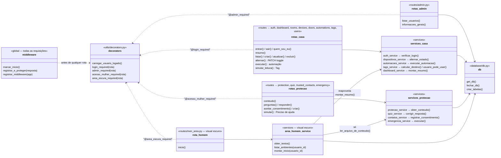

# Diagrama de "classes" (módulos) — E.L.O.

**Importante:** o backend do E.L.O. **não usa classes** do Python. Ele é feito de **módulos** (arquivos `.py`) com **funções**, porque assim fica mais simples de ler e explicar.
Por isso, neste diagrama, cada "caixa" é um **arquivo** e as linhas dentro dela são as **funções** principais. As setas mostram quem chama quem.

Observação sobre a seta `area_homem_service → services_protecao`: o service da área escura usa **apenas** a função que lê um arquivo `.json` (`ler_arquivo_de_conteudo`). Ele **não** lê nenhum dado da Proteção (contatos, alertas, quiz).

## Lista completa das funções por arquivo

| Arquivo | Funções |
|-|-|
| `middleware.py` | `marcar_inicio`, `deve_registrar`, `montar_linha`, `mostrar_no_terminal`, `registrar_e_proteger`, `registrar_middleware` |
| `utils/decorators.py` | `carregar_usuario_logado`, `login_required`, `admin_required`, `acesso_mulher_required`, `area_escura_required` |
| `utils/respostas.py` | `erro` |
| `utils/requisicao.py` | `ler_json`, `para_inteiro`, `para_sim_nao`, `texto` |
| `database/db.py` | `abrir_conexao`, `get_db`, `fechar_db`, `criar_tabelas`, `registrar_no_app` |
| `services/auth_service.py` | `tema_do_usuario`, `usuario_para_dict`, `buscar_usuario_por_id`, `buscar_usuario_por_email`, `normalizar_email`, `validar_cadastro`, `perfil_do_cadastro`, `cadastrar_usuario`, `verificar_login` |
| `services/comodos_service.py` | `comodo_para_dict`, `listar_comodos`, `buscar_comodo`, `comodo_pertence_ao_usuario`, `validar_nome`, `criar_comodo`, `atualizar_comodo`, `excluir_comodo` |
| `services/dispositivos_service.py` | `esta_ativo`, `dispositivo_para_dict`, `listar_dispositivos`, `buscar_dispositivo`, `validar_dispositivo`, `criar_dispositivo`, `atualizar_dispositivo`, `alternar_estado`, `excluir_dispositivo` |
| `services/portas_service.py` | `porta_para_dict`, `listar_portas`, `avisos_de_seguranca` |
| `services/automacoes_service.py` | `listar_acoes`, `automacao_para_dict`, `listar_automacoes`, `buscar_automacao`, `horario_valido`, `validar_acao`, `validar_acoes`, `validar_automacao`, `salvar_acoes`, `criar_automacao`, `atualizar_automacao`, `excluir_automacao`, `aplicar_acao`, `avisos_de_portas_e_janelas`, `executar_automacao` |
| `services/tags_service.py` | `tag_para_dict`, `listar_tags`, `buscar_tag`, `buscar_tag_por_codigo`, `normalizar_codigo`, `validar_tag`, `criar_tag`, `atualizar_tag`, `excluir_tag`, `calcular_destino`, `funcao_permitida`, `usuario_pode_usar` |
| `services/dashboard_service.py` | `contar`, `montar_resumo` |
| `services/area_homem_service.py` | `obter_textos`, `listar_ambientes`, `temperatura_do_ar`, `montar_inicio` |
| `services/protecao_service.py` | `ler_arquivo_de_conteudo`, `remover_anotacoes`, `obter_conteudo` |
| `services/quiz_service.py` | `listar_alternativas`, `listar_perguntas_ativas`, `texto_do_resultado`, `corrigir_resposta` |
| `services/contatos_service.py` | `obter_configuracoes`, `tem_consentimento`, `registrar_consentimento`, `contato_para_dict`, `listar_contatos`, `buscar_contato`, `contar_digitos`, `validar_contato`, `criar_contato`, `atualizar_contato`, `excluir_contato` |
| `services/emergencia_service.py` | `configuracoes_para_dict`, `ler_configuracoes`, `salvar_configuracoes`, `acoes_configuradas`, `registrar_alerta`, `simular_alerta_contatos`, `simular_localizacao`, `executar` |
| `services/usuarios_service.py` | `validar_perfil`, `atualizar_perfil` |
| `services/admin_service.py` | `usuario_para_dict_admin`, `listar_usuarios`, `buscar_usuario`, `linhas_para_lista`, `listar_comodos`, `listar_dispositivos`, `listar_tags`, `item_existe`, `excluir_item`, `contar`, `informacoes_gerais` |
