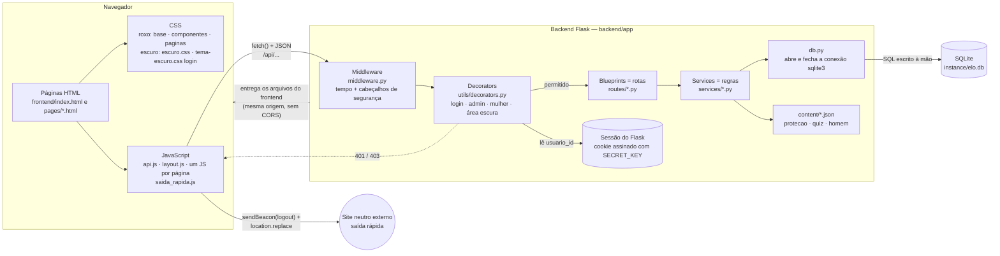

# Diagrama de componentes — E.L.O.

Mostra as **peças grandes** do sistema e quem conversa com quem.
Para abrir o desenho: GitHub e VS Code (com extensão de Mermaid) mostram o diagrama direto; ou cole o bloco em https://mermaid.live.



## Em texto

```
Navegador (HTML + CSS + JS)
   │  fetch("/api/...")  — envia e recebe JSON
   ▼
Flask
   ├─ middleware.py      → roda em TODA requisição (mede o tempo, põe cabeçalhos de segurança)
   ├─ decorators         → conferem login e permissão rota por rota (401 / 403)
   ├─ routes/ (Blueprints) → recebem a requisição e devolvem a resposta
   ├─ services/          → regras de negócio (validar, calcular, simular)
   ├─ content/*.json     → textos que a equipe edita (Proteção, quiz, visual escuro)
   └─ database/db.py     → conexão sqlite3
         ▼
      SQLite (instance/elo.db)
```

| Componente | Pasta / arquivo | Responsabilidade |
|-|-|-|
| Páginas | `frontend/index.html`, `frontend/pages/` (roxo) e `frontend/pages/escuro/` (visual escuro: homem, não definido e admin) | Estrutura de cada tela |
| Estilo | `frontend/css/` | Visual roxo (`base.css`, `componentes.css`, `paginas.css`); `escuro.css` (telas escuras); `tema-escuro.css` (login e cadastro) |
| Scripts | `frontend/js/` | Chamam a API, montam menu/cabeçalho (`layout.js`) e desenham os dados |
| Middleware | `backend/app/middleware.py` | Registro no terminal + cabeçalhos de segurança, em todas as requisições |
| Decorators | `backend/app/utils/decorators.py` | Quem pode acessar cada rota |
| Rotas | `backend/app/routes/` | Uma por assunto (auth, rooms, devices, tags, protection, men_area...) |
| Services | `backend/app/services/` | Regras de negócio, SQL e simulações |
| Conteúdo | `backend/app/content/` | Textos do doc da equipe e do Figma |
| Banco | `backend/app/database/` + `instance/elo.db` | Tabelas (`schema.sql`), conexão (`db.py`), dados de demonstração (`seed.py`) |
