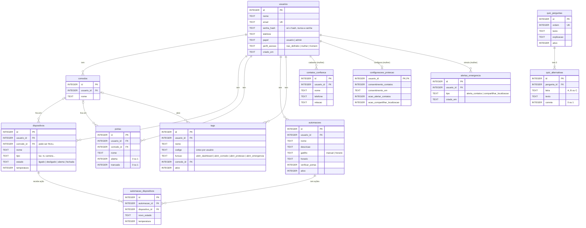

# Diagrama ER (entidade-relacionamento) — E.L.O.

Mostra as **tabelas** do banco SQLite e como elas se ligam. É o mesmo conteúdo de `backend/app/database/schema.sql`, em forma de desenho.

Como ler as ligações:
- `||--o{` = "um para muitos": **um** usuário tem **zero ou muitos** cômodos;
- `|o--o{` = o lado de cá pode ficar vazio (ex.: um dispositivo pode estar sem cômodo);
- `||--o|` = "um para zero ou um": cada usuária tem no máximo uma linha de configurações de proteção.

## Pontos para explicar na apresentação

- **Cada dado tem dono:** quase toda tabela tem `usuario_id`. As consultas sempre filtram por ele (`WHERE usuario_id = ?`), então um usuário nunca vê os dados de outro.
- **Apagar em cascata:** `ON DELETE CASCADE` apaga os cômodos, dispositivos etc. quando o usuário é apagado. `ON DELETE SET NULL` deixa o dispositivo "sem cômodo" quando o cômodo é apagado, em vez de apagar o dispositivo.
- **O quiz não tem `usuario_id`:** as perguntas são iguais para todas, e **as respostas não são salvas** (doc, seção 11).
- **O visual escuro não tem tabela própria:** perfil homem, perfil não definido e admin usam as mesmas tabelas da casa. A diferença está só no `perfil_acesso` (e no `papel`) e no visual.
- **Não existe tabela de log:** o middleware só imprime no terminal; nada de requisição é guardado no banco.
