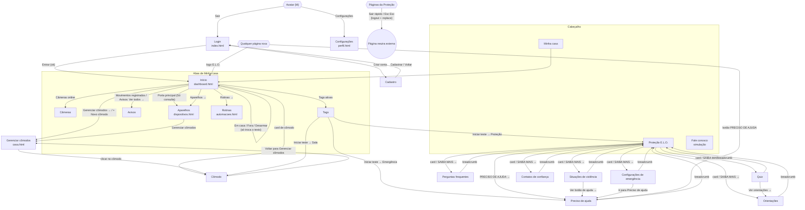
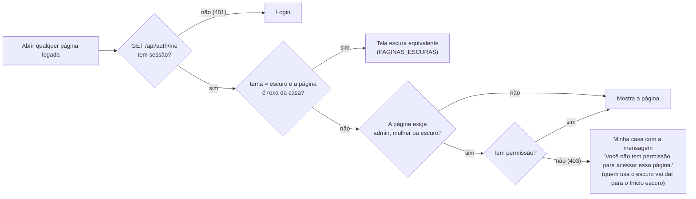
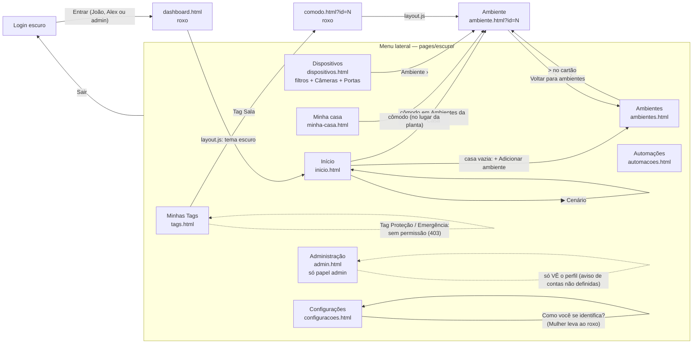
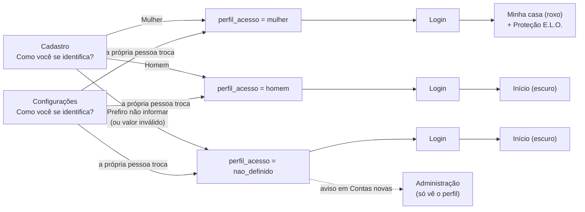

# Fluxo de navegação — E.L.O.

Este é o mapa que o frontend segue. Toda página tem caminho de ida **e** de volta.

- **Login e cadastro** são escuros e neutros para todos os perfis.
- **Visual roxo** (perfil mulher): segue as 14 imagens aprovadas em `docs/proposta/` (Figma roxo + melhorias; os selos "NOVO" das imagens não aparecem no sistema).
  - **Cabeçalho:** logo horizontal (`logo-elo-horizontal.png`) · Minha casa · Proteção E.L.O. · Fale conosco · "PRECISO DE AJUDA" · avatar (Configurações e Sair). **Rodapé:** logo completa (`logo-elo.png`) + "Projeto acadêmico de apoio e informação para mulheres. Em situação de emergência, ligue 190. Para orientação, ligue 180."
  - **Minha casa** tem as abas **Início · Câmeras · Aparelhos · Avisos · Tags · Rotinas** (Rotinas = automações). "Gerenciar cômodos" abre a lista de cômodos.
  - **Fale conosco:** dados de exemplo e envio só simulado.
  - **Proteção:** "Sair rápido" contornado no canto, aviso "Conteúdo informativo…" acima do rodapé, textos do doc como nas imagens 07 a 12.
- **Visual escuro** (perfil homem, perfil não definido e admin): telas em `frontend/pages/escuro/`, com o layout do Figma escuro e menu lateral. Câmeras é um filtro de Dispositivos. O admin tem "Administração" no menu lateral.
- Os dois visuais mostram a mensagem de "casa vazia" quando não há cômodos.

## Quem vê qual visual

| Pessoa | Visual | Proteção E.L.O. | Administração |
|-|-|-|-|
| `perfil_acesso = mulher` (ex.: Maria) | **roxo** (`pages/*.html`) | sim | — |
| `perfil_acesso = homem` (ex.: João) | **escuro** (`pages/escuro/*.html`) | não (403) | — |
| `perfil_acesso = nao_definido` (ex.: Alex, toda conta nova) | **escuro** | não (403) | — |
| `papel = admin` | **escuro** (sempre) | só se o perfil for mulher | sim (`pages/escuro/admin.html`) |

A regra fica num lugar só no backend: `tema_do_usuario()` em `backend/app/services/auth_service.py`. O `/api/auth/me` devolve o campo `"tema": "roxo"` ou `"escuro"`, e o `layout.js` segue esse campo.

## Páginas

| Página | Arquivo | Quem acessa | Referência visual |
|-|-|-|-|
| Login | `frontend/index.html` | todos | `01-inicial/01-login-hifi.png` (escuro) |
| Cadastro | `frontend/pages/cadastro.html` | todos | `01-inicial/02-cadastro-hifi.png` (escuro), com a pergunta obrigatória "Como você se identifica?" (Mulher / Homem / Prefiro não informar) |
| **Minha casa — Início** | `frontend/pages/dashboard.html` | roxo | `docs/proposta/01-minha-casa-inicio.png` e `02-minha-casa-vazia.png` |
| Minha casa — Câmeras | `frontend/pages/cameras.html` | roxo | `docs/proposta/03-cameras.png` |
| Minha casa — Aparelhos (+ Portas) | `frontend/pages/dispositivos.html` | roxo | `docs/proposta/04-aparelhos.png` |
| Minha casa — Avisos | `frontend/pages/avisos.html` | roxo | `docs/proposta/05-avisos.png` |
| Minha casa — Tags | `frontend/pages/tags.html` | roxo | `docs/proposta/06-tags.png` |
| Minha casa — Rotinas (automações) | `frontend/pages/automacoes.html` | roxo | sem imagem (componentes das outras telas) |
| Gerenciar cômodos | `frontend/pages/casa.html` | roxo | sem imagem; abre por "Gerenciar cômodos" |
| Cômodo | `frontend/pages/comodo.html?id=N` | roxo (dono do cômodo) | sem imagem |
| Configurações (Meu Perfil) | `frontend/pages/perfil.html` | roxo (pelo avatar) | `docs/proposta/14-configuracoes.png` |
| **Fale conosco** | `frontend/pages/fale-conosco.html` | roxo | `docs/proposta/13-fale-conosco.png` |
| Proteção E.L.O. e subpáginas | `frontend/pages/protecao*.html` | `perfil_acesso = mulher` | `docs/proposta/07` a `12`; Orientações e Configurações de emergência sem imagem |
| **Telas escuras** | `frontend/pages/escuro/*.html` | homem, não definido e admin | `06-perfil-homem/*.png` (ver "Visual escuro") |
| **Administração** (escura) | `frontend/pages/escuro/admin.html` | `papel = admin` | componentes do Figma escuro (não existe no Figma) |
| Página neutra (saída rápida) | site externo (previsão do tempo) | — | — |

## Diagrama — visual roxo (perfil mulher)

### Regras de proteção das páginas

O bloqueio de verdade acontece no **backend** (decorators `@login_required`, `@admin_required`, `@acesso_mulher_required` e `@area_escura_required`). O frontend só esconde os itens do menu e redireciona para a pessoa não ficar numa tela vazia.

## Visual escuro (homem, não definido e admin)

As telas escuras ficam em `frontend/pages/escuro/` e seguem o layout do Figma escuro (`06-perfil-homem/`). Elas usam as mesmas rotas da API das páginas roxas. No lugar do cabeçalho roxo aparece o **menu lateral**:

- **Redirecionamento (layout.js, `PAGINAS_ESCURAS`):** quem usa o escuro e abre uma página roxa da casa (`dashboard`, `casa`, `comodo`, `dispositivos`, `automacoes`, `tags`, `perfil`) vai para a tela equivalente em `pages/escuro/`, mantendo o `?id=...`.
- Não existe item **Proteção E.L.O.** nem botão **Preciso de ajuda** no visual escuro.
- **Dados de exemplo:** consumo, moradores, atividades, endereço, preferências, integrações, histórico etc. não existem no sistema. Os cards mostram dados **fictícios** do `content/homem.json` (bloco `exemplos`), sempre com o selo "Dados de exemplo" ou "Sincronizando…". A temperatura é a do ar-condicionado (simulado).
- Abrir uma tela de `pages/escuro/` com o perfil mulher leva a "Minha casa" (roxa) com a mensagem de sem permissão.

## Tabela de navegação

| Tela de origem | Botão / ação | Tela de destino | Regra de acesso |
|-|-|-|-|
| Login | Entrar (dados certos) | Minha casa (roxo) ou Início (escuro), conforme o tema | todos |
| Login | Entrar (dados errados) | Login (com mensagem de erro) | todos |
| Login | Criar conta | Cadastro | todos |
| Cadastro | Cadastrar | Login (mensagem "Conta criada, faça login"). O perfil vem de "Como você se identifica?": Mulher → `mulher` (roxo, com Proteção); Homem → `homem` (escuro); Prefiro não informar → `nao_definido` (escuro, aparece em destaque na Administração). O papel é sempre "usuario" | todos |
| Cadastro | Já tenho conta / Voltar | Login | todos |
| Qualquer página roxa | Cabeçalho: Minha casa · Proteção E.L.O. · Fale conosco | a tela escolhida (Proteção só para `perfil_acesso = mulher`) | roxo |
| Qualquer página roxa | Botão "PRECISO DE AJUDA" | Preciso de ajuda | só mulher |
| Qualquer página roxa | Avatar → Configurações / Sair | Configurações (`perfil.html`) / Login (sessão encerrada) | roxo |
| Qualquer página roxa | Logo E.L.O. | Minha casa (Início) | roxo |
| Telas de Minha casa | Abas Início · Câmeras · Aparelhos · Avisos · Tags · Rotinas | `dashboard` · `cameras` · `dispositivos` · `avisos` · `tags` · `automacoes` | roxo |
| Minha casa — Início | Em casa / Fora / Desarmar | Início (só muda o texto da faixa; nada é salvo) | roxo |
| Minha casa — Início | Cards Câmeras online · Porta principal · Movimentos registrados · Tags ativas | Câmeras · Aparelhos (filtro Portas) · Avisos · Tags | roxo |
| Minha casa — Início | Interruptor em "Controles rápidos" / "Aparelhos →" | Início (estado atualizado) / Aparelhos | roxo |
| Minha casa — Início | Card de cômodo / "Gerenciar cômodos →" / "+ Novo cômodo" | Cômodo / Gerenciar cômodos (`#novo` põe o cursor no formulário) | roxo |
| Minha casa — Início | Avisos "Ver todos →" / Rotinas "Rotinas →" / "▶ Executar" | Avisos / Rotinas / Início (`[SIMULAÇÃO]`) | roxo |
| Minha casa — Início | "Consumo de energia" e "Moradores" | só leitura: **dados de exemplo** com o selo "Dados de exemplo" (a própria pessoa aparece como administradora da casa, com "Morador A" e "Moradora B"); "Gerenciar acessos" fica desativado ("Em breve") | roxo |
| Minha casa — Início (casa vazia) | "+ Adicionar cômodo" | Gerenciar cômodos (`#novo`) | roxo |
| Câmeras | Interruptor / "Editar" / "+" tracejado | Câmeras (selo SIMULAÇÃO ou DESLIGADA; formulário com "Excluir" dentro) | roxo |
| Aparelhos | Filtros Todos · Luzes · Climatização · Cortinas e janelas · Sensores · Portas | Aparelhos (lista filtrada; portas com "Só consulta") | roxo |
| Aparelhos | "+ Novo aparelho" / "Editar" (com "Excluir" no formulário) / interruptor | Aparelhos (lista atualizada) | roxo |
| Aparelhos | "Gerenciar cômodos" | Gerenciar cômodos | roxo |
| Avisos | (só leitura) | — os avisos saem do estado real dos aparelhos e portas | roxo |
| Gerenciar cômodos | Novo / Renomear / Excluir / clicar no cômodo | Gerenciar cômodos (lista atualizada) / Cômodo | roxo |
| Cômodo | Ligar/Desligar / Voltar | Cômodo (estado atualizado) / Gerenciar cômodos | dono |
| Rotinas | Nova / Editar / Excluir / Ativar-Desativar / Executar (simulação) | Rotinas (lista atualizada, mensagem com o resultado) | roxo |
| Tags | "+ Nova Tag" / "Editar" (com "Excluir" no formulário) / interruptor | Tags (lista atualizada) | roxo |
| Tags | "Iniciar teste" (Tag "Sala" · "Proteção" · "Emergência") | Cômodo Sala · Proteção E.L.O. · Preciso de ajuda (Proteção e Emergência só para mulher; senão, mensagem de sem permissão) | logado |
| Rotinas / Aparelhos / Tags (vazias) | botão da mensagem de casa vazia | formulário da própria página (ou Gerenciar cômodos, se não há cômodos) | roxo |
| Configurações (`perfil.html`) | "Perfil e conta" → Salvar alterações | Configurações (mensagem de sucesso) | roxo |
| Configurações (`perfil.html`) | "Senha e segurança", "Notificações", "Aparência e acessibilidade" | desativados, com o selo "Em breve" (nada é salvo); "Privacidade" é só texto | roxo |
| Fale conosco | Enviar mensagem | Fale conosco (`[SIMULAÇÃO]`: nada é enviado nem salvo) | roxo |
| Proteção E.L.O. | Cards (SAIBA MAIS →) / "PRECISO DE AJUDA →" | a subpágina / Preciso de ajuda | mulher |
| Subpáginas da Proteção | Breadcrumb "Proteção E.L.O." | Proteção E.L.O. | mulher |
| Situações de violência | Sanfonas / "Ver botão de ajuda →" | abre o texto / Preciso de ajuda | mulher |
| Quiz | Responder / Próxima / Refazer / "Ver orientações →" | Quiz · Resultado · Orientações | mulher |
| Contatos de confiança | Caixas do Plano de segurança | marcam só na tela (nada é salvo) | mulher |
| Contatos de confiança | Primeiro acesso / "+ Adicionar contato" / ✎ / 🗑 | Contatos (consentimento ou lista atualizada) | mulher |
| Configurações de emergência | Salvar / Ir para Preciso de ajuda | Configurações / Preciso de ajuda | mulher |
| Preciso de ajuda | Seta → do Ligue 180 / 190 | abre os detalhes do canal (o número nunca vira ligação) | mulher |
| Preciso de ajuda | "Simular envio de alerta" / "Simular compartilhar localização" | Preciso de ajuda (`[SIMULAÇÃO] …`); o botão fica desativado se a ação estiver desligada nas Configurações de emergência | mulher |
| Páginas da Proteção | Sair rápido (ou Esc duas vezes) | Página neutra externa + sessão encerrada | mulher |
| Login (homem, não definido ou admin) | Entrar | `escuro/inicio.html` (via redirecionamento de `dashboard.html`) | escuro |
| Menu lateral | Início · Minha casa · Ambientes · Dispositivos · Automações · Minhas Tags · Configurações | `pages/escuro/`: inicio · minha-casa · ambientes · dispositivos · automacoes · tags · configuracoes | escuro |
| Menu lateral | **Administração** | `escuro/admin.html` | só `papel = admin` |
| Início (escuro) | Cômodo em "Ambientes da Casa" / cartões de número / ▶ Cenário | Ambiente · Dispositivos · Automações · Início (`[SIMULAÇÃO]`) | escuro |
| Início / Minha casa (escuro, casa vazia) | "+ Adicionar ambiente" | Ambientes escuro (`#novo` abre o formulário) | escuro |
| Ambientes (escuro) | "+ Adicionar ambiente" / cartão "+" | Ambientes (formulário) | escuro |
| Ambiente (escuro) | Interruptor / ▷ cena / Salvar nome / Excluir | Ambiente atualizado · Ambientes (depois de excluir) | escuro |
| Dispositivos (escuro) | Filtro · cartão · aba · Desligar/ligar · Editar · Excluir · "+ Novo" | Dispositivos (painel atualizado) | escuro |
| Automações (escuro) | Cartão · interruptor · Editar · Executar · Excluir · "+ Nova" | Automações (painel e "Atividade recente") | escuro |
| Configurações (escuro) | Editar perfil → Salvar alterações | Configurações (mensagem de sucesso) | escuro |
| Administração | Usuários · Cômodos · Dispositivos · Tags · Informações gerais | Administração (seção escolhida) | admin |
| Administração | Só leitura: a tabela mostra o perfil de cada conta; o quadro "Contas novas" é um AVISO ("Estas contas ainda não definiram o perfil. Peça para a pessoa escolher em Configurações > Como você se identifica?"). Não há seletor nem botões para mudar o perfil | — | admin |
| Configurações (roxo e escuro) | "Como você se identifica?" → Salvar | o perfil da própria pessoa muda na hora; se o visual muda (roxo ↔ escuro), vai para a tela inicial do visual novo | logado |
| Qualquer página logada, sem sessão | (automático) | Login | — |
| Página de admin, Proteção ou tela escura, sem permissão | (automático) | Minha casa com mensagem de sem permissão | — |
| Página roxa da casa, Câmeras, Avisos ou Fale conosco, com o visual escuro | (automático, `PAGINAS_ESCURAS`) | a tela escura equivalente (Câmeras → filtro Câmeras; Avisos → Dispositivos; Fale conosco → Início) | escuro |

## "Como você se identifica?" (cadastro e Configurações)

- O backend aceita só `mulher`, `homem` e `nao_definido`; qualquer outro valor vira `nao_definido` (`perfil_do_cadastro()` em `auth_service.py`). O **papel** nunca vem do formulário.
- Depois do cadastro, **só a própria pessoa** troca o perfil, em Configurações > "Como você se identifica?" (mesmas 3 opções). O admin **não** altera o perfil de ninguém: não existe rota para isso, e a Administração só mostra o perfil.
- Login e cadastro são neutros: nenhum texto sobre a Proteção ou sobre "área da mulher" (a palavra "Mulher" aparece só como opção da pergunta).

## O perfil é da própria pessoa

- **Configurações** (roxo: avatar → Configurações; escuro: menu lateral → Configurações) tem "Como você se identifica?" (Mulher / Homem / Prefiro não informar), sem citar a Proteção. Escolher "Mulher" leva ao visual roxo; "Homem" ou "Prefiro não informar", ao escuro.
- **Administração:** só consulta o perfil. As contas "não definido" aparecem num quadro de aviso, sem botões.
- **Tags:** "Abrir a Proteção E.L.O." e "Abrir o Preciso de ajuda" só aparecem no formulário do perfil mulher; para homem, não definido e admin o backend recusa criar ou editar Tag com essas funções (403). No seed, só a Maria recebe as Tags "Proteção" e "Emergência".
